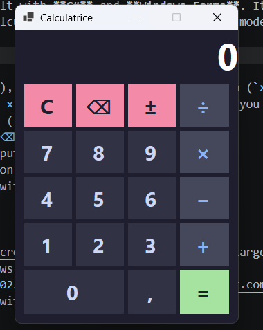

# Calculatrice graphique

A simple graphical calculator built with **C#** and **Windows Forms**. It provides the four basic arithmetic operations, chained calculations, keyboard support, and a modern dark-themed interface.

## Screenshot



## Features

- Basic operations: addition (`+`), subtraction (`−`), multiplication (`×`), and division (`÷`)
- Chained operations (e.g. `2 + 3 × 4` is evaluated left to right as you press the operators)
- Decimal input with comma or dot (`,` / `.`)
- Sign toggle (`±`), backspace (`⌫`), and clear (`C`)
- Division-by-zero and invalid-input error handling (`Erreur`)
- Full keyboard support in addition to mouse input
- Responsive, fixed-size dark UI with hover/press feedback

## Requirements

- [.NET 10 SDK](https://dotnet.microsoft.com/download) (the project targets `net10.0-windows`)
- Windows (Windows Forms is Windows-only)
- An IDE such as [Visual Studio 2022+](https://visualstudio.microsoft.com/) or [Visual Studio Code](https://code.visualstudio.com/) with the C# extension (optional)

## Build and run

From the repository root, using the .NET CLI:

```bash
cd Calculatrice
dotnet restore
dotnet run
```

Or build a release executable:

```bash
dotnet build -c Release
```

You can also open `Calculatrice.csproj` in Visual Studio and press **F5** to run the app.

## Keyboard shortcuts

| Key(s) | Action |
| --- | --- |
| `0`–`9` (top row or numpad) | Enter a digit |
| `,` / `.` / numpad decimal | Decimal separator |
| `+` | Add |
| `-` / numpad `-` | Subtract |
| `*` / numpad `*` | Multiply |
| `/` / numpad `/` | Divide |
| `Enter` / `=` | Evaluate |
| `Backspace` | Delete last digit |
| `Esc` / `Delete` | Clear |

## Project structure

```text
calculatrice graphique/
└── Calculatrice/
    ├── Calculatrice.csproj      # Project file (.NET 10, WinForms)
    ├── Program.cs               # Application entry point
    ├── Form1.cs                 # Calculator logic and input handling
    └── Form1.Designer.cs        # UI layout and styling
```

## How it works

Calculator state is held in `Form1` using three fields: the accumulator (`_acc`), the pending operator (`_op`), and a `_fresh` flag that tracks whether the next digit starts a new number. Each button and key press is routed through `Press(string)`, which dispatches to digit input, operator, equals, clear, backspace, or negate handlers. Display formatting uses `CultureInfo.InvariantCulture` so calculations are culture-independent, while the UI shows commas as the decimal separator.
